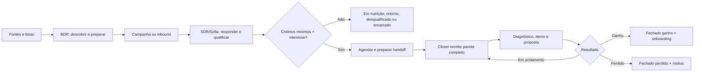

# 30Sales — especificação funcional para BDR, SDR e closer

Nome confirmado pelo usuário: **30Sales**. **Sofia** é a SDR virtual dentro do produto.

Data: 14/11/2026  
Status: proposta funcional para discussão; não descreve produto já implementado.

## 1. Objetivo do produto

Construir um produto comercial único que acompanhe cada empresa e cada contato desde a descoberta até o fechamento, reúna conversas e atividades em uma timeline, automatize o trabalho de BDR/SDR e entregue ao closer oportunidades com contexto verificável.

**Princípio de operação:** o closer deve receber uma oportunidade pronta para conduzir decisão e fechamento. Ele não deve precisar descobrir quem é a empresa, localizar a conversa, repetir a qualificação, procurar a origem, entender o pedido ou corrigir cadastros básicos.

O produto reduz trabalho operacional e organiza evidências. Ele não deve inventar dados, marcar reunião como confirmada sem confirmação, avançar estágio automaticamente sem evidência, nem prometer resultados ao cliente.

### Papéis comerciais

- **BDR (Business Development Representative):** pesquisa/enriquece empresas e contatos, executa prospecção outbound e mantém cobertura da base. Pode usar a Sofia para executar tarefas repetitivas, revisar exceções e construir listas priorizadas.
- **SDR (Sales Development Representative):** responde inbound e conversas, identifica interlocutor e necessidade, qualifica, conduz a próxima etapa e agenda/encaminha oportunidades aceitas. A Sofia atua como SDR automatizada sob políticas auditáveis; SDR humano pode assumir exceções e conversas estratégicas.
- **Closer:** recebe oportunidade qualificada, faz diagnóstico comercial final/demonstração, proposta, negociação e fechamento. Não recebe tarefas de saneamento de CRM, caça a contato, triagem de automações, nem primeira abordagem.
- **Gestor:** acompanha cobertura, conversão, velocidade, capacidade, qualidade e motivos de perda; configura metas, regras, roteamento e equipes.
- **Operador/admin:** mantém canais, integrações, permissões, prompts/políticas, quotas, calendários e incidentes.

BDR e SDR podem ser a mesma pessoa em uma equipe pequena. O produto deve separar as filas e responsabilidades por função, mas permitir que a mesma pessoa acumule papéis por permissão/configuração.

## 2. Jornada completa do lead

Cada transição registra ator, horário, motivo, origem, dados conhecidos, evidências e próxima ação. O lead pode ter vários contatos e oportunidades; a conversa pertence a um contato/canal e pode se relacionar a uma oportunidade específica.

## 3. Funcionalidades por módulo

### 3.1 Visão geral e fila de trabalho

- Início personalizado: “minhas tarefas de hoje”, novos leads, conversas sem responsável, reuniões próximas, tarefas vencidas e falhas de integração.
- Filas separadas: pesquisa BDR, prospecção pronta, respostas recebidas, qualificação pendente, reuniões/handoffs, follow-ups, oportunidades do closer e exceções.
- Priorização por urgência e intenção, nunca apenas por pontuação opaca. Mostrar sempre o motivo da prioridade e os dados usados.
- Filtros por equipe, responsável, segmento, origem, campanha, chip/canal, etapa, data e próximo passo.
- Ações em lote apenas para tarefas seguras (atribuir, etiquetar, exportar). Envio de mensagens em lote exige limites, prévia, autorização e trilha de auditoria.

### 3.2 Empresas, pessoas e mapa da base

- Cadastro da organização/empresa com nome legal e de uso, unidades, segmento, localização, tamanho/volume estimado e confirmado, domínio, telefone, canais, sistemas atuais e origem.
- Cadastro de pessoas com nome declarado, cargo/função, relação com compra, telefone/e-mail e preferências de contato. Distinguir decisor, influenciador, operador, recepção, contador e contato indicado.
- Vínculos empresa ↔ unidades ↔ contatos ↔ oportunidades ↔ conversas ↔ tarefas ↔ campanhas.
- Identidade e deduplicação assistidas por telefone, e-mail, domínio, identificador CRM e revisão humana. Telefone não pode ser chave única global de pessoa/empresa.
- Timeline cronológica com origem dos dados: informado pelo contato, importado de CRM/lista, inferido (marcado como hipótese) ou atualizado por integração.
- Pesquisa e segmentação salvas, importação CSV/API, enriquecimento rastreável e regras de validade/recência dos dados.
- Política de supressão/opt-out central: “não abordar” se propaga a campanhas e conectores; nenhuma automação pode contorná-la.

### 3.3 BDR: prospecção e preparação

- Fontes de leads: Twenty legado, CSV, formulário, integrações autorizadas e entrada manual.
- Enriquecimento: validação de telefone/WhatsApp, site, segmento e contatos; guardar fonte e data da evidência. Mostrar “desconhecido” quando não validado.
- Priorização de contas por critérios configuráveis (segmento, adequação, potencial, região, origem, atualização), com explicação e possibilidade de ajuste manual.
- Cadências outbound configuráveis por segmento/origem/campanha, com etapa, canal, janela, intervalo e condição de parada. As regras atuais de quotas, calendário, saúde de chips e proteção de números são controles obrigatórios, não prompts.
- Prévia antes de ativar campanha: amostra de empresas, textos, volume estimado por dia/canal, números elegíveis, exclusões, quota e risco operacional.
- Controles: pausar campanha, chip, canal, empresa ou todas as saídas; respeitar janelas/feriados; reservar quota atomicamente; limitar concorrência; verificar saúde do canal; confirmar entrega antes de avançar status.
- Resultados para o BDR: entregue, falhou, número inválido, sem WhatsApp, respondeu, resposta automática, sem resposta, pediu contato posterior, recusou, opt-out, encaminhou contato.
- O BDR recebe exceções acionáveis (contato inexistente, empresa errada, indicação, conflito de CRM) em vez de uma lista sem diagnóstico.

### 3.4 Inbox e SDR (Sofia + humano)

- Inbox omnicanal inicialmente centrado em WhatsApp, com inboxes/equipes por número e origem; no futuro, e-mail, formulário, ligação e outros canais.
- Conversas com busca, filtros, atribuição, notas privadas, mensagens públicas, anexos, transcrição de áudio, etiquetas, estado, SLA e link direto para empresa/oportunidade.
- Sofia pode responder, pedir informação, qualificar, agendar retorno, encaminhar a humano ou encerrar. Ações são estruturadas e passam por validação de políticas antes da execução.
- Uma única trava de ownership por conversa: Sofia, SDR humano ou closer. Quando humano assume, a Sofia fica silenciosa conforme a regra; qualquer retomada deve ser explícita e auditada.
- Respostas automáticas, ausência, transferência, menu de URA, resposta humana e resposta substantiva são classificadas separadamente; automação não pode virar aceite comercial por engano.
- Assistência ao SDR humano: resumo factual, últimas interações, perguntas já feitas, dados faltantes, resposta sugerida com fontes e políticas aplicáveis. O humano escolhe enviar.
- Transferência completa de contexto, sem recomeçar qualificação e sem tratar aceite de conversa como reunião marcada/negócio ganho.

### 3.5 Qualificação e prontidão do closer

O produto deve construir uma ficha comercial viva. Campos têm valores `confirmado`, `não informado`, `não aplicável` ou `em conflito`, além de fonte, data e confiança quando houver classificação automática.

**Conjunto recomendado para o handoff (não obrigar tudo antes de passar):**

1. Empresa correta e segmento.
2. Pessoa que conversou: nome declarado, função e telefone; se desconhecido, marcar claramente.
3. Problema/oportunidade ou motivo explícito do aceite.
4. Processo atual de cobrança e ferramenta, somente quando informado.
5. Volume relevante (alunos/cobranças/clientes) apenas quando informado; não inventar nem bloquear aceite por ausência.
6. Necessidade/caso de uso e recursos discutidos.
7. Objeções, perguntas pendentes e resposta já dada.
8. Origem do lead e campanha, com evidência.
9. Próxima conversa: data, hora e fuso concretos, status da confirmação, e-mail se necessário. Separar “preferência”, “proposta de horário”, “confirmado” e “convite enviado”.
10. Resumo curto, links da conversa e anexos relevantes.
11. Próxima ação do closer, responsável e prazo de SLA.

**Checklist de prontidão:** empresa/contato identificados ou lacunas visíveis; intenção/necessidade compreensível; aceite explícito ou exceção humana válida; sem opt-out/recusa ativa; handoff aceito por usuário/roteamento; compromisso corretamente rotulado. Um score pode ajudar a priorizar, mas não substitui esses critérios nem impede pedido explícito de humano.

O closer recebe um “brief de fechamento” e não apenas um alerta. A tela de oportunidade deve responder: quem é, por que está aqui, o que precisa, o que já foi combinado, o que falta, o que foi prometido e qual é o próximo passo.

### 3.6 Agenda e handoff

- Calendário integrado ao calendário real da equipe, disponibilidade por vendedor, fuso, duração/tipo de reunião e feriados.
- Sofia/SDR propõe somente janelas derivadas da disponibilidade configurada; não confirma sem resposta válida do lead e reserva atômica.
- Convite, link, participantes e status de entrega ficam ligados à oportunidade. Se agenda não estiver integrada, registrar como “contato combinado” e não como “reunião confirmada”.
- Handoff roteado por região/segmento/capacidade, com fila de fallback, SLA e escalonamento. Permitir aceitar/recusar transferência com motivo.
- O closer recebe alerta com link direto para oportunidade e conversa; o relógio de SLA começa no aceite/atribuição conforme política explícita.
- Se ninguém aceitar, a fila mantém o responsável anterior ou responsável de plantão; não perde o lead em um estado genérico.

### 3.7 Pipeline do closer

Pipeline base proposto (configurável, com mudanças auditadas):

1. **Qualificação SDR** — ainda não aceito para conversa comercial.
2. **Aceito para contato** — interesse/solicitação registrada; não presume reunião.
3. **Contato do closer pendente** — handoff aceito e ação inicial ainda não concluída.
4. **Diagnóstico agendado** — reunião com data/hora efetivamente confirmadas.
5. **Diagnóstico realizado** — conversa aconteceu; registrar participantes e resultado.
6. **Solução/escopo confirmado** — necessidade e aderência entendidas.
7. **Proposta em preparação**.
8. **Proposta enviada** — guardar versão, valor, validade e confirmação de recebimento quando houver.
9. **Negociação/decisão** — objeções, envolvidos, prazo de decisão e próximo passo.
10. **Fechado ganho** ou **Fechado perdido** — valor, data real e motivo obrigatório conforme regra.
11. **Nutrição/retomar depois** — com data/condição e dono explícitos; não é etapa ativa de fechamento.

Não usar “reunião”, “oportunidade”, “ganho” e “handoff” como sinônimos. O aceite da Sofia cria uma oportunidade ou tarefa de contato conforme política, não uma reunião concluída.

### 3.8 Tarefas, cadências e automações

- Tarefas com tipo, dono, prazo, empresa/contato/oportunidade, origem, status, evidência e dependências.
- Próxima ação obrigatória para oportunidade ativa; tarefa vencida sobe na fila sem criar mensagens duplicadas.
- Cadências comerciais podem combinar ações automáticas e humanas; cada passo tem critérios de entrada/saída e limite.
- Cancelar ou suspender cadência ao receber resposta, opt-out, handoff, reunião, mudança de dono, oportunidade ganha/perdida ou canal indisponível, conforme política.
- Scheduler com timezone, feriados e regras de dias úteis, idempotência, locks, retries e painel de falhas.
- Ação gerada por IA é uma proposta estruturada; a política bloqueia execução inválida e explica o bloqueio.

### 3.9 Conhecimento e governança da Sofia

- Editor de playbooks por produto, segmento, campanha, inbound/outbound e idioma.
- Regras categorizadas: política rígida, fato comercial, instrução de estilo e exemplo. Cada fato tem fonte, responsável, validade e data de revisão.
- Versões imutáveis de prompt/política, diffs, aprovação, publicação escalonada, rollback e associação de cada conversa à versão usada.
- Simulador com casos reais anonimizados, regressões por objeção/recusa/handoff, comparação de modelo e validação de JSON/ação.
- Catálogo de ações que a Sofia pode propor; validação determinística de opt-out, estado da conversa, horário, agenda, preço permitido e limite de mensagens.
- Monitor de qualidade para falsa qualificação, repetição, dados inventados, promessas, resposta a recusa, handoff perdido e falha de parse.

### 3.10 Painéis, métricas e gestão

- **Cobertura BDR:** contas pesquisadas, contatáveis, tentativas entregues/falhas, contatos localizados, respostas, opt-outs e motivos de exclusão.
- **Sofia/SDR:** tempo até primeira resposta, resposta substantiva vs automação, qualificação, aceite, handoff, retorno vencido, silêncio, recusa e falha técnica.
- **Handoff:** aceites pendentes, SLA de primeira ação, tempo até contato, conversões, devoluções por falta de contexto e reuniões confirmadas.
- **Closer:** pipeline e valor por etapa, envelhecimento, próxima ação vencida, conversão por coorte/origem, ciclo de venda, ganho/perda e motivos.
- **Operação:** saúde do Evolution/chips, fila, webhooks atrasados, jobs em retry, taxa de entrega, erros Anthropic/STT, custo por canal/campanha e sincronização de CRM.
- Definições de métricas versionadas. Coorte de aquisição deve usar primeira abordagem confirmada; close date é fechamento real; ausência de histórico não prova ausência de contato.
- Dashboards respeitam permissão e filtram organização/equipe sem misturar inbound/outbound ou campanhas.

## 4. Status e estados — separar objetos, não criar um status gigante

Um mesmo lead participa de estados diferentes ao mesmo tempo: a empresa pode estar pesquisada, o contato em conversa e uma oportunidade em proposta. O produto deve manter dimensões separadas.

### 4.1 Estado de prospecção da conta (BDR)

`não pesquisada` → `em pesquisa` → `pronta para abordar` → `em cadência` → `contato localizado` → `respondeu` → `convertida para SDR`.

Saídas e exceções: `sem dados`, `telefone inválido`, `sem WhatsApp`, `duplicada`, `fora do perfil`, `não abordar/opt-out`, `bloqueada por canal`, `sem resposta após cadência`, `pausada`. Guardar motivo e data; opt-out não pode ser revertido por campanha nova sem base legítima e revisão.

### 4.2 Estado da conversa (Inbox)

`nova` → `aguardando Sofia` / `aguardando SDR` → `em atendimento` → `aguardando lead` → `retorno agendado` → `handoff pendente` → `assumida pelo closer` → `resolvida`.

Estados finais/contextuais: `encerrada`, `sem resposta`, `opt-out`, `spam`, `falha de canal`. `Aguardando lead` é estado da conversa, não etapa de oportunidade.

### 4.3 Status de qualificação SDR

`não iniciada` → `em descoberta` → `qualificada` / `aceite para contato` → `handoff solicitado` → `handoff aceito`.

Saídas: `nutrição com data`, `sem aderência`, `recusou`, `sem resposta`, `revisão humana`, `opt-out`. “Qualificada” deve ter critérios que a equipe possa inspecionar; a ausência de um dado não é automaticamente desqualificação.

### 4.4 Etapa da oportunidade

Usar o pipeline do closer definido acima. Separar `stage` de `outcome` (`aberta`, `ganha`, `perdida`, `desqualificada`) e de `forecast category` se houver previsão comercial.

### 4.5 Estado técnico da automação

`recebido` → `validado` → `reservado` → `executando` → `confirmado`.

Exceções: `repetido/idempotente`, `bloqueado por política`, `aguardando retry`, `revisão humana`, `falha permanente`, `cancelado`. Isso permite distinguir o lead silencioso de uma mensagem que nunca foi enviada.

## 5. Dados mínimos que chegam ao closer

O cartão de handoff deve trazer:

- Empresa, segmento, unidade, origem/campanha e identificadores externos.
- Contato e função, com fonte do nome/telefone e conflitos visíveis.
- Pedido/aceite literal ou resumo fiel com link para mensagens de origem.
- Dor/objetivo, processo/sistema atual e volume informados; dados desconhecidos ficam marcados como desconhecidos.
- Recursos/preço/condições que foram explicados, perguntas ainda abertas e objeções.
- Histórico de interações e ações já tentadas; resultado de cada envio separado da resposta recebida.
- Próximo passo, responsável, prazo interno, data/hora combinada e se a reunião está confirmada.
- Sinais de risco e limites: recusa anterior, opt-out, canal preferido, janela de contato, informação em conflito.
- Recomendação de abordagem da IA com justificativa e fonte, identificada como sugestão.

Se faltar item, o produto aponta a lacuna; não completa com inferência apresentada como fato. O closer deve conseguir começar o atendimento sem perguntar de novo o que já foi respondido.

## 6. Integrações e destino de cada aplicação

| Sistema atual | Papel atual | Estratégia no produto |
| --- | --- | --- |
| Evolution API | Sessões e transporte WhatsApp | Manter como adaptador de canal; trazer conexão, saúde, envio e confirmação para o console. Isolar regras comerciais do protocolo Evolution. |
| Chatwoot (legado) | Inbox, histórico, agentes e notas atuais | Pode ser fonte de importação histórica. Não será backend, executor de mensagens nem conector operacional do 30Sales. O Inbox e ownership serão nativos; transporte direto via Evolution ou WhatsApp Business Cloud API. |
| Twenty | CRM, Companies/People/Opportunities/tasks e origem da prospecção | Importar e sincronizar durante transição. Produto assume CRM operacional necessário à jornada; conector Twenty fica opcional para coexistência/export. |
| n8n | Orquestra workflows A–H e monitor | Migrar responsabilidade para jobs versionados no produto. Manter temporariamente para tarefas auxiliares; eliminar fluxos duplicados após reconciliação. |
| PostgreSQL Sofia | Histórico, estado, filas e configuração | Migrar para schema de domínio do produto com IDs estáveis, auditoria, migrações e plano de retenção. Não copiar scripts históricos como arquitetura final. |
| Anthropic | Conversa/classificação | Provider IA do produto com políticas, limites, custo, fallback e logs de versão. |
| Whisper/OpenAI | Transcrição de áudio | Serviço de mídia/STT substituível; guardar texto e metadados de origem, aplicar retenção a áudio. |
| SMTP/alertas WhatsApp | Notificações internas | Centralizar notificações dentro do produto e usar e-mail/WhatsApp interno como canais de entrega redundantes. |
| Calendário | Não integrado segundo os guias operacionais | Integrar antes de chamar horários de reunião “confirmados”; Google/Microsoft via adaptador e reserva concorrente. |

## 7. Navegação principal do aplicativo

1. **Hoje** — tarefas e alertas priorizados por usuário.
2. **Inbox** — conversas por fila, equipe e canal.
3. **Leads** — mapa de empresas e pessoas, filtros e listas.
4. **Campanhas** — origem, cadência, público, quotas, prévia, estado e resultados.
5. **Qualificação** — leads respondidos, dados faltantes e prontidão do handoff.
6. **Pipeline** — oportunidades do closer e forecast.
7. **Agenda** — disponibilidade, compromissos, reuniões e tarefas.
8. **Relatórios** — BDR, SDR/Sofia, handoff, closer, canal e qualidade.
9. **Conhecimento da Sofia** — playbooks, fatos, políticas, testes e versões.
10. **Integrações e operação** — Evolution, WhatsApp Business Cloud API, Twenty, IA, fila, erros, credenciais e auditoria.
11. **Administração** — usuários, equipes, papéis, metas, roteamento, calendário e configuração.

## 8. MVP recomendado

### MVP 1 — Visibilidade e registro confiável

- Login, papéis, empresas, contatos, oportunidades, tarefas e timeline.
- Importação histórica opcional de Chatwoot e integrações read-only com Twenty; estado/saúde dos canais WhatsApp no 30Sales.
- Inbox unificada em modo leitura, filas e filtros.
- Mapa de status por conta, conversa, qualificação, oportunidade e job técnico.
- Handoff brief e relatórios de cobertura/pendências.
- Auditoria, deduplicação e importação reconciliável.

**Critério de saída:** a equipe consegue localizar qualquer lead e entender fonte, status, última interação, responsável e próxima ação sem abrir sistemas diferentes.

### MVP 2 — BDR/SDR assistidos

- Atribuição, notas, tarefas, registro manual e sugestões da Sofia.
- Dry-run/shadow para regras de qualificação, handoff e cadências.
- Inbox nativo com fila compartilhada, ownership/assunção atômica, pausa da Sofia, respostas humanas pelo provedor original e retomada explícita da Sofia.
- Pipeline e prontidão do closer; nada envia automaticamente sem fluxo legado como executor único.

**Critério de saída:** os dados e decisões do novo produto reconciliam com o legado; equipe faz handoff rastreado de ponta a ponta.

### MVP 3 — Automação com tráfego controlado

- Fila durável, outbox, idempotência, retries, monitor e kill switch.
- Migrar um fluxo de cada vez: alertas/monitor → handoff/CRM → follow-up → inbound → campanha cold.
- Envio limitado a grupo piloto/allowlist, com quota menor ou igual à produção e comparação de resultados.
- Tela de saúde por chip e pausa imediata.

**Critério de saída:** nenhuma perda/duplicidade na janela piloto e rollback demonstrado sem reimportar workflow concorrente.

### MVP 4 — Independência operacional de Chatwoot e Twenty

- Inbox e CRM interno com histórico, mensagens, contatos, empresas, tarefas e oportunidades.
- Migração de registros com mapeamento de IDs e reconciliação por contagem/hash/amostra.
- Chatwoot não faz parte do runtime. Twenty pode permanecer como conector CRM opcional; desligamento da fonte legada só após reconciliação e operação segura.

## 9. Regras de produto não negociáveis

- Não enviar se houver opt-out, ownership humano, pausa de campanha/chip, janela inválida ou falha de saúde do canal.
- Não duplicar ações após retry/webhook repetido; sempre separar pedido de envio, aceite da API e confirmação de entrega quando disponível.
- Não tratar automação/boas-vindas, envio efetuado ou aceite para conversar como reunião realizada ou venda.
- Não sobrescrever recusa, handoff humano, compromisso ou evidência mais recente por evento antigo.
- Não inventar dados nem esconder lacunas; guardar evidência que sustenta classificações e mudanças.
- Prompt não é banco de dados nem mecanismo de autorização: políticas críticas são verificadas no código/domínio.
- Toda alteração de prompt, política, quota, status, dono e integração tem ator, versão, data e rollback.
- O closer recebe contexto e próximos passos; não recebe ruído de automação nem tarefas sem responsável.

## 10. Métricas de sucesso do produto

- Percentual de leads com empresa, contato, origem e responsável resolvidos.
- Percentual de oportunidades ativas com próxima ação e data válidas.
- Tempo entre resposta/aceite e primeiro contato humano do closer.
- Percentual de handoffs aceitos pelo closer sem devolução por falta de contexto.
- Retrabalho: perguntas repetidas, duplicatas, tarefas sem evidência e correções de CRM.
- Conversão por coorte: abordado → resposta humana → qualificado → aceite → reunião confirmada → proposta → ganho.
- Cobertura e precisão da identificação de respostas automáticas vs humanas, sempre amostradas.
- Envios duplicados/perdidos; falhas de integração; tempo de recuperação; custo por lead e oportunidade.
- Opt-outs respeitados e incidentes de canal por campanha.
- Tempo do closer dedicado a conversas de fechamento versus pesquisa, triagem e saneamento.

Metas numéricas devem ser definidas após uma linha de base real. Os números históricos dos relatórios existentes têm escopos e classificações distintos; não devem ser combinados sem normalizar a definição.

## 11. Decisões funcionais sugeridas

1. Usar empresa, pessoa, conversa, lead SDR, oportunidade e campanha como entidades separadas, ligadas por IDs estáveis.
2. Deixar BDR/SDR responsáveis pela qualidade da entrada e pelo handoff; closer responsável por diagnóstico, negociação e desfecho.
3. Permitir passagem ao humano antes de toda qualificação se o contato pedir; o produto marca lacunas para o closer.
4. Exigir próxima ação em todo registro aberto, com responsável e prazo; exceções (aguardando lead) têm estado e regra claros.
5. Não equiparar “aceitou falar” a reunião confirmada; confirmar via resposta do lead ou calendário.
6. Criar um score explicável de prontidão, nunca uma caixa-preta bloqueante.
7. Construir desde o primeiro schema como SaaS multi-tenant: tenant/organização, membership, autorização server-side, escopo obrigatório em dados/jobs/cache/storage e isolamento entre clientes. 3035Tech/30Pay pode ser o primeiro tenant, sem exceções estruturais. Billing e white-label podem ser adiados; isolamento multiempresa não.

## 12. Questões para fechar antes de wireframes e backlog

- O BDR será sempre humano, parcialmente automatizado ou também executado pela Sofia para pesquisa/listas?
- O closer terá agenda integrada logo no MVP ou o primeiro passo será registrar e confirmar manualmente?
- O funil e os critérios de qualificação mudam por segmento/campanha ou há um processo 30Pay padrão?
- O lead pode ter várias oportunidades simultâneas para produtos/unidades diferentes?
- Quais canais entram depois do WhatsApp: ligação, e-mail, formulário, Instagram/Meta?
- O CRM interno substitui o Twenty em todos os processos 30Pay ou apenas na operação Sofia/comercial?
- Qual política de retenção para mensagens, áudio, contatos e listas importadas?
