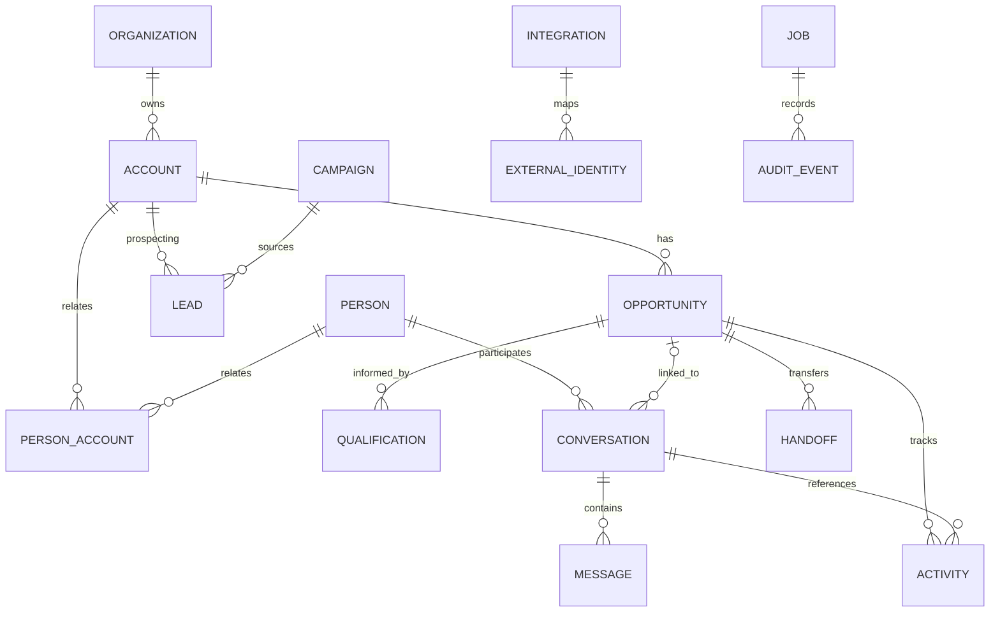

# 1. 30Sales — visão, escopo, papéis e navegação

O **30Sales** é uma plataforma SaaS multi-tenant. Cada empresa cliente é uma organização isolada, com seus próprios usuários e dados; um usuário pode pertencer a mais de uma organização. **Sofia** é a SDR virtual integrada ao produto. O tenant ativo é resolvido e autorizado pelo backend em toda operação.

## Objetivo e resultado operacional

O 30Sales deve ser a ferramenta de trabalho única da operação comercial: importar e preparar a base, abordar e qualificar por SDR IA, atender conversas no Inbox e conduzir oportunidades até o fechamento. O registro de cada empresa, contato, conversa, reunião, tarefa e oportunidade permanece ligado no mesmo histórico. Toda fila deixa claro **quem faz o quê, até quando e por qual motivo**.

### Fluxo comercial e vocabulário

- **LDR é entrada de dados, não um papel de usuário:** arquivos e integrações importam empresas e contatos, com validação, deduplicação e rastreio da origem. A importação não inicia contato por si só.
- **SDR é a IA de prospecção:** recebe leads elegíveis da base importada, aborda pelo canal configurado, registra toda mensagem e resposta no Inbox, qualifica fatos e lacunas e pede ajuda humana quando necessário.
- **BDR e closer são pessoas da operação:** revisam exceções, assumem conversas quando necessário, conduzem reuniões, atualizam a oportunidade no pipeline e mantêm a próxima ação visível.
- **Inbox é a superfície principal de comunicação:** lista de conversas, thread, contexto do lead e ações de atendimento ficam acessíveis juntos. Texto, imagem, documento e áudio enviados/recebidos pertencem à mesma timeline com estado de entrega.
- **Pipeline é o quadro de acompanhamento da venda:** etapas e oportunidades precisam estar visíveis, ter nomes claros e abrir o histórico/ações sem esconder o estado atual.
- **Reunião é uma atividade rastreável:** criar horário, participantes e link/local, enviar convite, acompanhar aceite, alteração, cancelamento, realização ou ausência no histórico da conversa e oportunidade.

Automação de abordagem respeita consentimento, opt-out, janela e política do canal. Uma falha de importação, provedor, entrega ou convite fica visível como ação operacional; nunca se converte em sucesso comercial silencioso.

Sucesso do desenho: um usuário abre uma oportunidade e encontra a conversa, origem, empresa correta, interlocutor, fatos confirmados, lacunas, objeções, acordos, responsável e próxima ação sem procurar em três aplicações.

## Papéis e visões do produto

Há dois níveis de identidade e autorização. O **superadmin** pertence à plataforma 30Sales e atua sobre a carteira de empresas. Os demais papéis são memberships dentro de uma empresa/tenant; eles nunca concedem acesso a outra empresa. Uma identidade global pode ser membro de várias organizações e ter um papel diferente em cada uma.

| Perfil | Escopo e visão principal | Ações centrais |
| --- | --- | --- |
| Superadmin da plataforma | Console global de empresas, estado da conta e onboarding; não recebe acesso cotidiano às conversas ou ao CRM de clientes | Cadastrar/ativar empresa e definir o responsável inicial. Acesso excepcional a dados de cliente, se necessário para suporte, deve ser explícito e auditado |
| Responsável da empresa (`owner`) | Visão completa do próprio tenant, operação e resultados da equipe | Convidar usuários, atribuir papéis, configurar canais, políticas e pipelines; acompanhar closers e resultados |
| Gestor (`manager`) | Visão operacional agregada da empresa/equipe | Distribuir carteira, acompanhar filas e métricas, apoiar a equipe conforme as permissões concedidas |
| Closer (`closer`) | Cockpit pessoal: conversas e oportunidades atribuídas, handoffs, tarefas e próximos passos | Atender, registrar atividades e atualizar as próprias oportunidades. A visão padrão é da carteira atribuída; dados de outros closers aparecem somente por compartilhamento/permissão da empresa |
| BDR (`bdr`) | Revisão humana de leads e apoio às conversas da carteira autorizada | Corrigir dados, tratar exceções, assumir conversas e encaminhar oportunidades |
| Operações (`operations`) | Saúde de canais, jobs, importações e auditoria operacional do tenant | Configurar e recuperar integrações sem acessar segredos em texto claro |
| Analista (`analyst`) | Indicadores autorizados em modo de leitura | Consultar relatórios sem executar ações comerciais |

Uma empresa pode ter vários usuários `closer`. O papel define capacidades e visão inicial; atribuição/ownership define quais registros comerciais entram na carteira individual. O responsável da empresa continua vendo o conjunto autorizado do tenant. A mesma pessoa pode ser `owner` em uma empresa e `closer` em outra.

O agente SDR é uma identidade de automação do tenant, não uma pessoa que precisa de convite/login. Operações com impacto externo guardam canal, destinatário, execução da IA e estado de entrega, e podem ser assumidas por BDR/closer conforme a política.

O perfil controla a experiência do dia a dia, não apenas o menu: início/cockpit, navegação, ações e filtros padrão mudam por papel. Exemplos: closer inicia em **Minha central**; responsável inicia em **Visão da equipe**; superadmin entra no console de empresas sem precisar selecionar um tenant. URLs protegidas e chamadas diretas continuam sendo autorizadas no backend.

## Permissões funcionais

| Papel | Pode ver | Pode alterar | Não pode por padrão |
| --- | --- | --- | --- |
| BDR | Contas atribuídas/fila de pesquisa, campanhas e atividades próprias/equipe | Enriquecer conta/contato, preparar listas, lançar tentativa/resultado, solicitar abordagem | Marcar ganho, editar política global, remover opt-out |
| SDR humano | Inbox e qualificações atribuídas, ficha do lead | Conversar, qualificar, agendar retorno, criar/atualizar handoff | Marcar ganho sem papel comercial autorizado; alterar limites de canal |
| Sofia (ator de sistema) | Contexto permitido da conversa e conhecimento publicado | Propor/solicitar ações autorizadas; registrar decisão e execução | Ignorar bloqueios, remover opt-out, assumir conversa humana, confirmar reunião sem agenda/resposta |
| Closer | Oportunidades atribuídas, conversas e brief | Diagnóstico, atividade, etapa, proposta, resultado, motivo de perda | Editar origem original/consentimento sem revisão; alterar execução técnica ou consultar automaticamente a carteira de colegas |
| Responsável/gestor | Dados da empresa e visões da equipe autorizadas | Atribuição, prioridade, metas, roteamento e permissões permitidas | Alterar histórico auditado ou apagar evidência |
| Admin de operação | Integrações, filas, configurações e logs operacionais | Credenciais, canais, políticas, publicação e recuperação | Acessar/mostrar segredo em texto claro; reprocessar efeitos externos sem idempotência |
| Auditor | Histórico, configurações e evidências | Anotações de auditoria | Enviar mensagem ou mudar etapa |

O papel global `superadmin` não é um papel de organização e não deve ser incluído no seletor de convites da empresa. A criação de empresa deve gerar um tenant isolado e convidar/definir o primeiro responsável como `owner`; closers e demais usuários entram por memberships e convites desse tenant. A interface pode esconder módulos indisponíveis, mas cada endpoint e cada consulta de dados também deve validar papel, tenant e escopo de ownership no servidor.

As permissões se combinam com escopo: organização, equipe, proprietário ou registro atribuído. Todas as mudanças registram ator humano/sistema, escopo e timestamp.

## Navegação e shell

Menu lateral contextual ao papel:

1. **Hoje** — fila pessoal e alertas.
2. **Inbox** — conversas e handoffs.
3. **Contas** — empresas, pessoas e cobertura BDR.
4. **Campanhas** — listas, cadências, quotas e envios.
5. **Qualificação** — fila SDR e prontidão.
6. **Pipeline** — oportunidades do closer.
7. **Agenda** — compromissos, disponibilidade e tarefas.
8. **Relatórios** — funil, produtividade, canal e qualidade.
9. **Conhecimento Sofia** — playbooks e versões.
10. **Operação** — integrações, saúde, execuções e auditoria (admin).
11. **Configurações** — usuários, equipes, calendários e políticas.

Shell persistente: seletor de organização/equipe, busca global, botão de criar, notificações, ajuda, usuário/fuso horário. Para superadmin, o shell mostra o console global e não exige organização ativa. Para membros, módulos e destino inicial seguem o membership da organização ativa. Busca global procura contas, pessoas, telefone/e-mail, conversa, tarefa e oportunidade respeitando tenant, papel e ownership.

## Objetos e relações

Uma conta pode ter múltiplas pessoas, leads/campanhas e oportunidades. Uma conversa pode existir antes da oportunidade e depois ser vinculada; não se duplica a thread quando a oportunidade é criada.

## Princípios de UX

- Fila primeiro: a tela inicial destaca ação e prazo, não apenas gráficos.
- Em telas de detalhe, resumo e próxima ação acima da timeline; histórico não fica escondido em tabs profundas.
- Cada status tem definição acessível e consequência mostrada antes de mudança sensível.
- Dados incertos são rotulados como hipótese ou conflito, nunca apresentados no mesmo estilo de dado confirmado.
- Ações externas mostram prévia, canal/remetente, destinatário e efeito esperado; envio manual tem confirmação.
- Diferenciar relógio de SLA interno de compromisso combinado com cliente.
- Atalhos e ações em lote respeitam o mesmo bloqueio de opt-out, permissões e política.

## Escopo explicitamente posterior ao MVP

Billing SaaS, white-label, discador, e-mail marketing avançado, sequências omnicanal complexas, previsão de receita com ML, enriquecimento pago em lote e construtor visual genérico de workflows. O isolamento multi-tenant, membership, autorização e auditoria são fundação do MVP, não escopo posterior.
