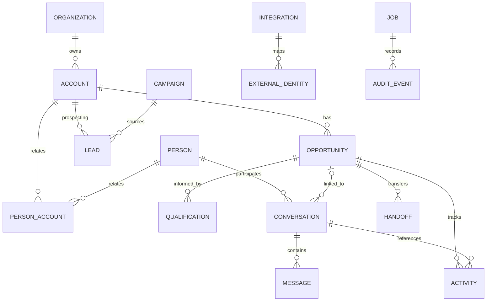

# 1. 30Sales — visão, escopo, papéis e navegação

O **30Sales** é uma plataforma SaaS multi-tenant. Cada empresa cliente é uma organização isolada, com seus próprios usuários e dados; um usuário pode pertencer a mais de uma organização. **Sofia** é a SDR virtual integrada ao produto. O tenant ativo é resolvido e autorizado pelo backend em toda operação.

## Objetivo e resultado operacional

O produto mantém um registro contínuo e auditável de cada conta, pessoa, conversa, qualificação e oportunidade. BDR trabalha cobertura e qualidade da base; Sofia/SDR responde e qualifica; closer recebe contexto suficiente para conduzir a venda. Toda fila deixa claro **quem faz o quê, até quando e por qual motivo**.

Sucesso do desenho: um usuário abre uma oportunidade e encontra a conversa, origem, empresa correta, interlocutor, fatos confirmados, lacunas, objeções, acordos, responsável e próxima ação sem procurar em três aplicações.

## Papéis e permissões funcionais

| Papel | Pode ver | Pode alterar | Não pode por padrão |
| --- | --- | --- | --- |
| BDR | Contas atribuídas/fila de pesquisa, campanhas e atividades próprias/equipe | Enriquecer conta/contato, preparar listas, lançar tentativa/resultado, solicitar abordagem | Marcar ganho, editar política global, remover opt-out |
| SDR humano | Inbox e qualificações atribuídas, ficha do lead | Conversar, qualificar, agendar retorno, criar/atualizar handoff | Marcar ganho sem papel comercial autorizado; alterar limites de canal |
| Sofia (ator de sistema) | Contexto permitido da conversa e conhecimento publicado | Propor/solicitar ações autorizadas; registrar decisão e execução | Ignorar bloqueios, remover opt-out, assumir conversa humana, confirmar reunião sem agenda/resposta |
| Closer | Oportunidades atribuídas, conversas e brief | Diagnóstico, atividade, etapa, proposta, resultado, motivo de perda | Editar origem original/consentimento sem revisão; alterar execução técnica |
| Gestor | Dados da equipe e relatórios agregados | Atribuição, prioridade, metas, roteamento e permissões permitidas | Alterar histórico auditado ou apagar evidência |
| Admin de operação | Integrações, filas, configurações e logs operacionais | Credenciais, canais, políticas, publicação e recuperação | Acessar/mostrar segredo em texto claro; reprocessar efeitos externos sem idempotência |
| Auditor | Histórico, configurações e evidências | Anotações de auditoria | Enviar mensagem ou mudar etapa |

As permissões se combinam com escopo: organização, equipe, proprietário ou registro atribuído. Todas as mudanças registram ator humano/sistema, escopo e timestamp.

## Navegação e shell

Menu lateral:

1. **Hoje** — fila pessoal e alertas.
2. **Inbox** — conversas e handoffs.
3. **Contas** — empresas, pessoas e cobertura BDR.
4. **Campanhas** — listas, cadências, quotas e envios.
5. **Qualificação** — fila SDR e prontidão.
6. **Pipeline** — oportunidades do closer.
7. **Agenda** — compromissos, disponibilidade e tarefas.
8. **Relatórios** — funil, produtividade, canal e qualidade.
9. **Conhecimento Sofia** — playbooks e versões.
10. **Operação** — integrações, saúde, execuções e auditoria (admin).
11. **Configurações** — usuários, equipes, calendários e políticas.

Shell persistente: seletor de organização/equipe, busca global, botão de criar, notificações, ajuda, usuário/fuso horário. Busca global procura contas, pessoas, telefone/e-mail, conversa, tarefa e oportunidade respeitando permissões.

## Objetos e relações

Uma conta pode ter múltiplas pessoas, leads/campanhas e oportunidades. Uma conversa pode existir antes da oportunidade e depois ser vinculada; não se duplica a thread quando a oportunidade é criada.

## Princípios de UX

- Fila primeiro: a tela inicial destaca ação e prazo, não apenas gráficos.
- Em telas de detalhe, resumo e próxima ação acima da timeline; histórico não fica escondido em tabs profundas.
- Cada status tem definição acessível e consequência mostrada antes de mudança sensível.
- Dados incertos são rotulados como hipótese ou conflito, nunca apresentados no mesmo estilo de dado confirmado.
- Ações externas mostram prévia, canal/remetente, destinatário e efeito esperado; envio manual tem confirmação.
- Diferenciar relógio de SLA interno de compromisso combinado com cliente.
- Atalhos e ações em lote respeitam o mesmo bloqueio de opt-out, permissões e política.

## Escopo explicitamente posterior ao MVP

Billing SaaS, white-label, discador, e-mail marketing avançado, sequências omnicanal complexas, previsão de receita com ML, enriquecimento pago em lote e construtor visual genérico de workflows. O isolamento multi-tenant, membership, autorização e auditoria são fundação do MVP, não escopo posterior.
